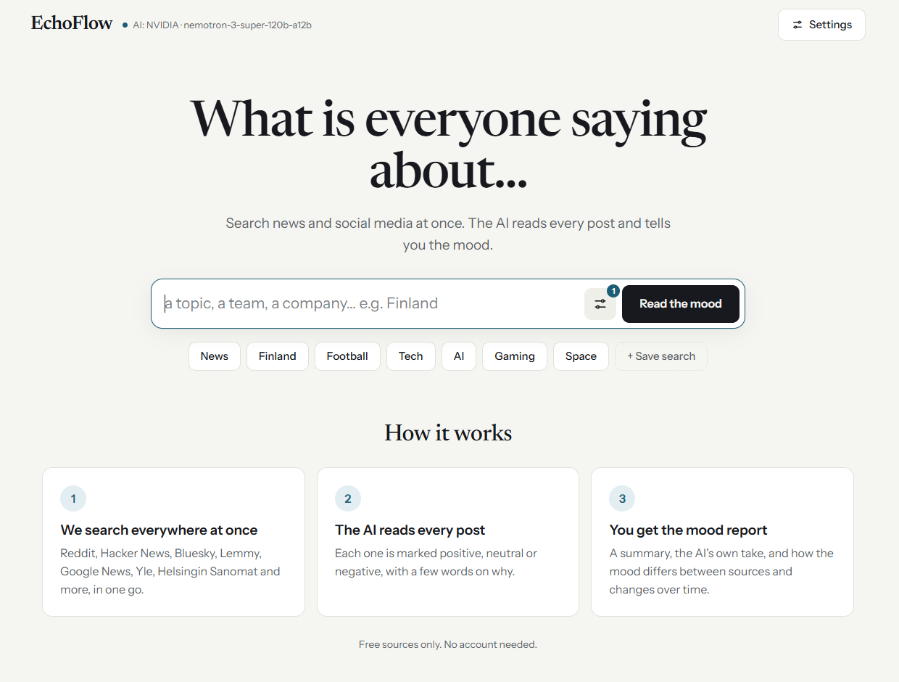

# EchoFlow



> One search box for news and social media. Type a topic, see the most-talked-about posts, and let the AI sum up the mood and give its own take. Zero cloud cost.

EchoFlow searches Reddit, Hacker News, Bluesky, Lemmy, Google News and free news APIs from [public-apis](https://github.com/public-apis/public-apis#news) in parallel. It analyses the results with NVIDIA NIM (free cloud) or local Ollama and shows everything on a single page, colour-coded by mood. Everything runs in Docker: one command and you're up.

EchoFlow is a school project for an AI course. **How the AI part works, how we chose the model and what we learned about prompting: [docs/ai-design.md](docs/ai-design.md).**

---

## Table of Contents

- [Features](#features)
- [Architecture](#architecture)
- [Prerequisites](#prerequisites)
- [Quick Start — Docker](#quick-start--docker)
- [Local Development](#local-development)
- [Environment Variables](#environment-variables)
- [Supported Sources](#supported-sources)
- [The UI](#the-ui)
- [AI evaluation](#ai-evaluation)
- [API Reference](#api-reference)
- [Adding a New Platform](#adding-a-new-platform)
- [Project Structure](#project-structure)
- [Troubleshooting](#troubleshooting)
- [Authors](#authors)
- [License](#license)

---

## Features

- **One page, one search box** — type `News, Finland` and every comma-separated topic is searched across all enabled sources at once
- **Top 10 + AI side by side** — most popular / latest posts on the left; AI summary, the AI's own opinion, themes and a colour-coded mood bar on the right
- **Colour-coded results** — the AI labels every post green (positive), grey (neutral) or red (negative) and says why in a few words; click a mood to filter
- **Measured, not guessed** — `npm run eval` scores models on 50 hand-labelled posts; the chosen model gets 98% vs 64% for a keyword list ([details](docs/ai-design.md))
- **Ask the results** — ask a question in plain language; the AI answers only from the posts found (retrieval-augmented generation) and links the posts it used
- **Stories** — posts about the same thing (in any language) are grouped into stories by a local embedding model
- **Mood toward…** — mood toward a specific person, company or place (e.g. Google vs EU), not just the overall tone
- **Mood by source & over time** — the same topic on Reddit vs Yle vs Bluesky, and how its mood changes day by day (analyses are saved in PostgreSQL)
- **Model comparison** — run NVIDIA and Google Gemini on the same posts and see both analyses side by side, their agreement score and every post they disagree on
- **English or Finnish** — the AI can write its summary, opinion and reasons in Finnish (Settings)
- **Quick-search buttons** — News, Finland, Football, Tech… Add your own, and optionally attach a curated RSS feed bundle (World, Finland, Tech, Gaming, Esports)
- **Free sources only** — Most sources work with no key at all; 8 more news APIs from public-apis switch on with a free key (on the server via `.env`, or per browser in Settings → API keys)
- **Free AI, two tiers** — set `NVIDIA_API_KEY` for high-accuracy cloud inference via [NVIDIA NIM](https://build.nvidia.com) (free endpoint); falls back to local Ollama automatically
- **Export & import** — download results with mood labels and AI analysis as CSV or JSON from Settings, and open them again later
- **Pluggable sources** — a new news API is one entry in `news-api-collector.ts`; a new platform is one collector class + one `register()` call
- **Persistent storage (optional)** — every analysis is saved in PostgreSQL for mood over time; `POST /api/search` can also save the raw posts with `persist: true`

---

## Architecture

```
┌─────────────────────────────────────────────────────────────────┐
│                           EchoFlow                              │
│                                                                 │
│  ┌──────────┐   ┌───────────────────────────────────────────┐  │
│  │  Web UI  │   │           REST API (Express)              │  │
│  │  / (one  │   │  /api/discover  /api/platforms  /api/...  │  │
│  │   page)  │   │                                           │  │
│  └──────────┘   └──────────────────┬──────────────────────── ┘ │
│                                    │                            │
│                  ┌─────────────────▼──────────────────────┐    │
│                  │           CollectorRegistry             │    │
│                  │   register()   get()   getAll()         │    │
│                  └──┬──────────────┬───────────────────┬───┘   │
│                     │              │                   │        │
│         ┌───────────▼──┐  ┌────────▼───────┐  ┌───────▼────┐  │
│         │ Social       │  │ News APIs      │  │  RSS/Atom  │  │
│         │ Reddit · HN  │  │ Google News    │  │  any feed  │  │
│         │ Bluesky ·    │  │ Spaceflight +  │  │            │  │
│         │ Lemmy        │  │ 8 free-key APIs│  │            │  │
│         └──────────────┘  └────────────────┘  └────────────┘  │
│                                                                 │
│  ┌──────────────────────────────────────────────────────────┐  │
│  │  AI Provider (priority order)                            │  │
│  │  1. NVIDIA NIM — nemotron-3 super → ultra (free cloud)   │  │
│  │  2. Google Gemini (free tier)                            │  │
│  │  3. Your own OpenAI-compatible model (optional)          │  │
│  │  4. Ollama     — llama3.2:3b (local Docker fallback)     │  │
│  │  Offline Hugging Face classifier labels moods if the     │  │
│  │  cloud providers fail; local embeddings power Ask,       │  │
│  │  Stories and Mood toward…                                │  │
│  │  POST /api/analytics/analyze → sentiment, summary,       │  │
│  │  opinion, themes, insights, per-post labels — free       │  │
│  └──────────────────────────────────────────────────────────┘  │
│                                                                 │
│  ┌──────────────────────────────────────────────────────────┐  │
│  │  PostgreSQL 16                                           │  │
│  │  searches · posts · comments · search_posts ·            │  │
│  │  mood_history (mood over time)                           │  │
│  └──────────────────────────────────────────────────────────┘  │
└─────────────────────────────────────────────────────────────────┘
```

### Key design decisions

| Decision | Reason |
|---|---|
| One `/api/discover` call per search | All sources run in parallel; one failing source never fails the search, it is just reported |
| Table-driven news APIs | Each public-apis news API is a ~15-line definition, not a new class |
| User keys stay in the browser | Settings stores keys in localStorage and sends them only with the user's own search requests |
| Collector registry pattern | Adding a platform is one file + one `register()` call, no route changes |
| `channels` abstraction | Subreddits, HN tags, feed URLs — one field each collector maps to its own concept |
| RSS/Atom collector | Any site with a feed is instantly supported — no custom collector needed |
| NVIDIA NIM → Gemini → Ollama, plus an offline classifier | Free cloud models for accuracy; local models keep it working with no key and no internet |
| Opt-in persistence (`persist: true`) | Exploratory searches stay fast; you only hit the DB when you want to |

---

## Prerequisites

**Docker path (recommended):**
- [Docker Desktop](https://www.docker.com/products/docker-desktop/) 4.x or later

**Local path:**
- Node.js 20+, npm 9+, PostgreSQL 16

---

## Quick Start — Docker

**1. Clone and configure**

```bash
git clone https://github.com/arttujussikil/echoflow.git
cd echoflow
cp .env.example .env
```

Open `.env` and set a `DB_PASSWORD`. Everything else works as-is for local use.

**2. (Optional) Add a free NVIDIA API key for better AI accuracy**

Get a free key at [build.nvidia.com](https://build.nvidia.com) → any model → "Get API Key". Add it to `.env`:

```
NVIDIA_API_KEY=nvapi-xxxxxxxxxxxx
```

Without any AI key, EchoFlow still works: mood labels come from an offline Hugging Face model (~280 MB, downloaded once on first start) and the summary from local Ollama (~2 GB, pulled on first use). A free Gemini key (`GEMINI_API_KEY`) is another option.

**3. Start all services**

```bash
docker compose up --build
```

Four containers start:

| Container | Purpose | URL |
|---|---|---|
| `echoflow-web` | Node.js API + web UI | `http://localhost:3000` |
| `echoflow-db` | PostgreSQL 16 | `localhost:5432` |
| `echoflow-ollama` | Local LLM fallback (Ollama) | `localhost:11434` |
| `echoflow-adminer` | Visual database browser | `http://localhost:8888` |

The database schema is applied automatically from `src/db/init/01_schema.sql`.

**4. Open the UI**

```
http://localhost:3000
```

Everything is on that one page. The ⚙ **Settings** button (top right) holds sources and API keys, quick-search buttons, time range, export/import and AI info.

**5. Hard-refresh after any rebuild**

After `docker compose up --build`, press **Ctrl+Shift+R** in the browser to bypass cached JS.

**6. Verify**

```bash
curl http://localhost:3000/health
# → {"status":"ok","service":"echoflow","timestamp":"..."}

curl http://localhost:3000/api/platforms
# → {"platforms":[{"id":"reddit",...},{"id":"hackernews",...},{"id":"guardian",...,"apiKey":{...}}, ...]}
```

---

## Local Development

```bash
npm install
cp .env.example .env
# set DB_HOST=localhost in .env

npm run dev    # ts-node, no build step needed
npm run build  # compile TypeScript → dist/
npm start      # run compiled output
```

---

## Environment Variables

| Variable | Default | Description |
|---|---|---|
| `PORT` | `3000` | HTTP port |
| `NODE_ENV` | `development` | Set to `production` in compiled builds |
| `DB_HOST` | `db` | Postgres host (`db` in Docker, `localhost` locally) |
| `DB_PORT` | `5432` | Postgres port |
| `DB_USER` | `echoflow` | Postgres user |
| `DB_PASSWORD` | — | **Required** — set before first run |
| `DB_NAME` | `echoflow` | Postgres database name |
| `NVIDIA_API_KEY` | — | Free NVIDIA NIM API key — get one at [build.nvidia.com](https://build.nvidia.com). When set, used as **primary** AI provider. |
| `NVIDIA_MODEL` | `nvidia/nemotron-3-super-120b-a12b,nvidia/nemotron-3-ultra-550b-a55b` | NVIDIA NIM model IDs, comma-separated, tried in order |
| `GEMINI_API_KEY` | — | Free [Google AI Studio](https://aistudio.google.com/apikey) key. Adds Gemini as a backup provider and enables the side-by-side model comparison |
| `GEMINI_MODEL` | `gemini-3.8-flash,gemini-3.5-flash` | Gemini model IDs, comma-separated, tried in order |
| `CUSTOM_AI_URL` / `CUSTOM_AI_MODEL` | — | Your own model: any OpenAI-compatible API (OpenRouter, Groq, LM Studio, llama.cpp…), e.g. `https://openrouter.ai/api/v1`. Tried after Gemini, selectable in Settings → AI, included in the model comparison and in `npm run eval` |
| `CUSTOM_AI_KEY` / `CUSTOM_AI_NAME` | — / `Custom model` | Its API key (empty for local servers) and the name shown in the UI |
| `OLLAMA_HOST` | `http://ollama:11434` | Ollama service URL (local fallback) |
| `OLLAMA_MODEL` | `llama3.2:3b` | Local Ollama model (last resort for the summary) |
| `LOCAL_SENTIMENT_MODEL` | `onnx-community/twitter-xlm-roberta-base-sentiment-ONNX@q8` | Offline Hugging Face classifier that labels moods when the cloud AI doesn't answer. `off` disables it |
| `LOCAL_MODEL_CACHE` | `./models-cache` (`/app/models-cache` in Docker, a volume) | Where the local models are downloaded |
| `EMBEDDING_MODEL` | `Xenova/multilingual-e5-small@q8` | Local embedding model for Stories, Ask the results and Mood toward… (`off` disables them) |
| `TRACK_TOPICS` | — | Topics to analyse automatically for Mood over time, comma-separated (`|` joins a multi-keyword search) |
| `TRACK_EVERY_HOURS` | `6` | How often the tracker runs |
| `REDDIT_CLIENT_ID` / `REDDIT_CLIENT_SECRET` | — | Optional Reddit OAuth app. Without it, Reddit search falls back to RSS (no scores) |
| `GUARDIAN_API_KEY`, `NYT_API_KEY`, `GNEWS_API_KEY`, `NEWSDATA_API_KEY`, `CURRENTS_API_KEY`, `THENEWSAPI_KEY`, `NEWSAPI_KEY`, `MEDIASTACK_API_KEY` | — | Optional free news API keys, see [Supported Sources](#supported-sources). Each source turns on when its key is set |

**AI provider priority:** NVIDIA NIM → Google Gemini → Ollama for the summary and opinion. For the mood labels: NVIDIA → Gemini → the **offline Hugging Face model** (runs inside the web container, ~280 MB, labels only, no reasons) → Ollama. Each is skipped if not configured; all are free. The **⇄ Compare NVIDIA vs Gemini** button in the AI card runs both providers on the same posts with no fallback between them.

**Recommended NVIDIA NIM models** (free tier, set via `NVIDIA_MODEL`):

| Model | Notes |
|---|---|
| `nvidia/nemotron-3-super-120b-a12b` | **Default, first choice** — 98% on our 50-post sentiment benchmark, ~14 s per 50 posts |
| `nvidia/nemotron-3-ultra-550b-a55b` | **Default backup** — 97%, ~20 s; free endpoint is often busy (503) |
| `nvidia/nemotron-3.5-lightning-30b-a3b` | 87% — not recommended |

Numbers from `npm run eval` on 2026-10-09; see [AI evaluation](#ai-evaluation).

NVIDIA retires models from time to time (e.g. `mistralai/mistral-nemotron` now returns HTTP 410). If analysis falls back to Ollama, check the server log and pick a current model from `https://integrate.api.nvidia.com/v1/models`.

**Ollama fallback models** (local, no internet needed, set via `OLLAMA_MODEL`):

| Model | Size | Notes |
|---|---|---|
| `llama3.2:3b` | ~2 GB | **Default** — good structured output |
| `llama3.2:1b` | ~600 MB | Lighter but unreliable for analysis |
| `llama3.1:8b` | ~4.7 GB | Best local quality, needs more RAM |

---

## Supported Sources

Pick which ones to search with the **filter button** next to the search bar. News APIs that need a key show a lock until a key is added in **Settings → API keys** or `.env`.

### No key needed

| Source | How | Notes |
|---|---|---|
| Reddit | JSON API, or RSS search when JSON is blocked (403) | Scores and comment counts only with `REDDIT_CLIENT_ID`/`SECRET` |
| Hacker News | [Algolia HN API](https://hn.algolia.com/api) | Scores + comments |
| Bluesky | `api.bsky.app` public search | Likes, reposts, replies |
| Lemmy | lemmy.world → lemmy.ml → beehaw.org | Scores + comments |
| Google News | Google News RSS search | Headlines from thousands of outlets |
| Spaceflight News | [spaceflightnewsapi.net](https://spaceflightnewsapi.net) | From public-apis; space & science |

### Free key (from [public-apis → News](https://github.com/public-apis/public-apis#news))

| Source | Free tier | Get a key | Env var |
|---|---|---|---|
| The Guardian | 500 requests/day | [open-platform.theguardian.com](https://open-platform.theguardian.com/access/) | `GUARDIAN_API_KEY` |
| New York Times | 500 requests/day | [developer.nytimes.com](https://developer.nytimes.com/get-started) | `NYT_API_KEY` |
| GNews.io | 100 requests/day | [gnews.io](https://gnews.io/register) | `GNEWS_API_KEY` |
| NewsData.io | 200 requests/day | [newsdata.io](https://newsdata.io/register) | `NEWSDATA_API_KEY` |
| Currents | free tier (see site) | [currentsapi.services](https://currentsapi.services/en/register) | `CURRENTS_API_KEY` |
| TheNewsAPI | 100 requests/day, 3 articles each | [thenewsapi.com](https://www.thenewsapi.com/register) | `THENEWSAPI_KEY` |
| NewsAPI.org | 100 requests/day, articles ≤ 1 month old | [newsapi.org](https://newsapi.org/register) | `NEWSAPI_KEY` |
| Mediastack | 100 requests/month (HTTP only) | [mediastack.com](https://mediastack.com/signup/free) | `MEDIASTACK_API_KEY` |

Free-tier limits are the providers' own figures and change from time to time. Every keyword in a search costs one request per source.

### Finnish newspapers (no key needed)

| Source | How |
|---|---|
| **Google News Suomi** (on by default) | All Finnish media in one search via Google News' Finnish edition |
| Yle, Helsingin Sanomat, Ilta-Sanomat, Iltalehti, MTV Uutiset, Kaleva, Aamulehti, Turun Sanomat, Savon Sanomat, Keskisuomalainen, Satakunnan Kansa, Kauppalehti, Maaseudun Tulevaisuus, Uusi Suomi, Hufvudstadsbladet (off by default, pick in the filters) | Google News Finland restricted to the paper's site (`site:kaleva.fi`); the paper's own RSS feed is the fallback if Google News fails |

Finnish papers have no public search APIs: Yle's API ([developer.yle.fi](https://developer.yle.fi/en/index.html)) needs registration and no longer serves news content, and RSS feeds only list the latest articles. Single papers are off by default so a normal search doesn't send 15 extra requests to Google News. Add or fix a paper in `FINNISH_OUTLETS` (`src/collectors/finnish-news-collector.ts`).

### RSS / Atom feeds

Quick-search buttons can attach a curated feed bundle (World, Finland, Tech, Gaming, Esports; see `FEED_BUNDLES` in `public/app.js`). Through the API, any feed works: `POST /api/discover` with `feeds: [...]`, or `POST /api/search` with `platforms: ["rss"]` and feed URLs in `channels`.

> **Cloudflare-protected sites** (e.g. HLTV forum threads) block automated HTTP. Use the site's news RSS feed instead.

---

## The UI

A single page at `http://localhost:3000`:

1. **Search bar.** Comma-separated topics (`News, Finland`) are each searched across every enabled source.
   The **filter button** (sliders icon) next to it sets the time range, results per source and which sources to search, e.g. only the New York Times. A number on the button shows how many filters differ from the defaults; changing them re-runs the current search.
2. **Quick-search buttons** under it. Click one to search; **+ Save search** turns the current search into a button. Manage the buttons in Settings.
3. **Top 10** (left): most popular by engagement, or latest.
4. **AI analysis** (right): mood bar (green / grey / red), summary, the AI's own opinion, themes and insights. Click a mood to filter the list below.
5. **All results**, colour-coded by mood and filterable by mood and source. The AI labels every result (up to 200) and the mood bar is counted from those labels; a `*` after the mood means the AI couldn't label that post and it was estimated from keywords.
6. **Why a colour?** Each post shows the AI's reason next to its mood (e.g. *negative — forest cleared for data centre*); hover a dot in the Top 10 to see it.
7. **Ask the results.** Ask a question (or click a suggestion). The 15 posts most similar in meaning are retrieved and the AI answers from them only, with [n] links to the posts.
8. **Mood toward…** Type up to 3 names (or click a suggested one): every post that names them, plus the most similar ones, is labelled positive / neutral / negative *toward that name*.
9. **Mood by source** (by platform or by outlet) and **Mood over time** (by publish date, or earlier saved analyses of the same search).
10. **All results → Stories** groups posts about the same story; each story shows how many posts and sources covered it and their mood.

**Settings (⚙, top right):** export/import CSV & JSON, AI language and provider info, quick-search buttons, API keys for the news APIs.

Old URLs (`/ui/news`, `/ui/reddit`, `/ui/analytics.html`, …) redirect to the main page. `/?q=News,Finland` opens a search directly.

---

## AI evaluation

How good is the mood labelling? `eval/sentiment-benchmark.ts` runs the app's own labelling prompt against 50 hand-labelled posts ([`eval/headlines.json`](eval/headlines.json)) and compares models with a keyword list.

```bash
npm run eval                                          # default models, 2 runs each
npm run eval -- --prompt both --runs 3 --out eval/results/my-run.md
```

Latest results ([full report](eval/results/2026-10-09.md)):

| Method | Accuracy |
|---|---|
| Keyword list (no AI) | 64% |
| Nemotron 3 Super (default) | **98%** |
| Nemotron 3 Ultra (backup) | 97% |
| Nemotron 3.5 Lightning | 87% |
| Gemini 3.5 Flash (free tier) | 98% |
| Gemini 3.8 Flash (free tier) | 100% in 1 run; endpoint busy in 2 of 3 runs |
| NVIDIA models with the old "ordered list" prompt | 35–62% |

Gemini rows: [Gemini report](eval/results/2026-10-09-gemini.md).

Method, prompt design and limitations: [docs/ai-design.md](docs/ai-design.md).

---

## API Reference

All endpoints under `http://localhost:3000/api`.

---

### POST /api/discover

The single search behind the main page. All sources run in parallel; failures are reported per source instead of failing the request.

```jsonc
// Request
{
  "query": "News, Finland",          // comma-separated, up to 5 keywords
  "sources": ["reddit", "guardian"], // optional; default = every source that is ready
  "timeRange": "week",               // "hour"|"day"|"week"|"month"|"year"|"all"
  "limit": 15,                       // per source, per keyword (max 50)
  "feeds": ["https://feeds.yle.fi/uutiset/v1/recent.rss?publisherIds=YLE_NEWS"], // optional RSS, included unfiltered
  "apiKeys": { "guardian": "..." }   // optional per-request keys (override env)
}

// Response
{
  "query": "News, Finland",
  "keywords": ["News", "Finland"],
  "sources": {
    "reddit":   { "name": "Reddit", "count": 30 },
    "guardian": { "name": "The Guardian", "count": 0, "skipped": true, "error": "No API key — add one in Settings" }
  },
  "results": [ /* Post objects, de-duplicated; metadata.keyword says which keyword matched */ ],
  "totalResults": 30,
  "timestamp": "..."
}
```

---

### POST /api/search

Lower-level, per-platform search with modes, channels, comments and optional persistence.

```jsonc
{
  "platforms": ["reddit", "hackernews", "rss"],
  "mode": "top",            // "search" | "latest" | "top"
  "keyword": "TypeScript",  // required for mode=search
  "channels": ["programming", "https://hnrss.org/frontpage"],
  "timeRange": "week",      // "hour"|"day"|"week"|"month"|"year"|"all"
  "limit": 25,
  "fetchComments": true,
  "commentLimit": 5,
  "commentSort": "top",     // "top"|"best"|"new"
  "persist": false,
  "filters": {
    "minEngagement": 10,
    "sortBy": "recent"      // "recent"|"likes"|"comments"
  }
}
```

If some platforms fail, their errors appear in `platformErrors` and results from working platforms are still returned.

**Response formats:** append `?format=csv` or `?format=html` for alternative outputs.

---

### GET /api/platforms

Returns every registered source, its category (`social` / `news` / `feed`) and whether it needs a key.

```jsonc
{
  "platforms": [
    { "id": "reddit", "displayName": "Reddit", "category": "social", "description": "...",
      "capabilities": { "search": true, "latest": true, "top": true, "comments": true, "requiresAuth": false } },
    { "id": "guardian", "displayName": "The Guardian", "category": "news", "description": "...",
      "capabilities": { "search": true, "latest": false, "top": false, "comments": false, "requiresAuth": true },
      "apiKey": { "envVar": "GUARDIAN_API_KEY", "signupUrl": "https://open-platform.theguardian.com/access/", "configured": false } }
  ]
}
```

---

### POST /api/analytics/analyze

Runs AI analysis on up to 200 posts. Two requests run in parallel: a summary/opinion of the first 25 posts, and a sentiment label for **every** post (batches of 40, each post a numbered key so the model can't drift). The sentiment percentages are computed from those labels. Uses the NVIDIA models in `NVIDIA_MODEL` in order, then Ollama.

```jsonc
// Request
{ "posts": [...], "keyword": "Counter-Strike", "language": "en", "provider": "gemini" }
// language: "en" | "fi"; provider (optional): "nvidia" | "gemini" — use only that provider, no fallback

// Response
{
  "sentiment":  { "positive": 55, "neutral": 30, "negative": 15 },
  "themes":     ["team performance", "tournament format", "player transfers"],
  "summary":    "Community discussion focuses on recent tournament results...",
  "opinion":    "The hype looks justified: results back it up, but the roster worries are real.",
  "articleLabels": ["pos", "neu", "neg", null, "..."], // one per post sent, in order (null = not labelled)
  "articleReasons": ["record attendance", "match preview", "star player injured", null, "..."],
  "labelledCount": 87,
  "mood":       "excited",
  "insights":   ["Team roster changes are the dominant topic.", "Sentiment spikes around major announcements."],
  "postCount":  25,
  "provider":   "nvidia:nvidia/nemotron-3-super-120b-a12b",
  "language":   "en",
  "analyzedAt": "2026-05-12T10:00:00.000Z"
}
```

Returns 503 if Ollama is not yet ready (first pull can take a few minutes).

---

### POST /api/analytics/ask

Ask the results (RAG). Embeds the question and the posts, keeps the 15 most similar, and answers from those only.

```jsonc
// Request
{ "question": "Why are people negative?", "posts": [{ "title": "…", "content": "…", "source": "Reddit", "mood": "negative" }], "language": "en" }
// Response
{ "answer": "Authorities halted the data centres over forest clearing [1][3].", "citations": { "1": 12, "3": 40 }, "retrieved": [12, 7, 40, …], "retrieval": "embeddings (multilingual-e5-small)", "provider": "nvidia:…" }
```
`citations` maps each [n] in the answer to an index in the `posts` you sent.

---

### POST /api/analytics/stories

Groups posts about the same story: titles are embedded locally and clustered (average linkage, cosine ≥ 0.88).

```jsonc
{ "posts": [{ "title": "…" }] }   →   { "stories": [[0, 4, 9], [2, 7]], "threshold": 0.88, "model": "multilingual-e5-small" }
```

---

### POST /api/analytics/target

Mood toward up to 3 targets. For each target: posts that name it plus the most similar ones (max 60), labelled pos / neu / neg toward the target, or na.

```jsonc
{ "targets": ["Google", "EU"], "posts": [{ "title": "…", "content": "…" }] }
→ { "results": [{ "target": "Google", "considered": 35, "directMentions": 15, "counts": { "pos": 0, "neu": 0, "neg": 15, "na": 20 },
                  "posts": { "12": { "s": "neg", "r": "halt ordered over forest clearing" } }, "provider": "nvidia:…" }] }
```

---

### GET /api/history?topic=Finland&days=90

Saved mood snapshots for a search, oldest first. `POST /api/analytics/analyze` saves one when it gets `topic`. `GET /api/history/topics` lists topics with history.

```jsonc
{ "topic": "Finland", "available": true, "points": [{ "at": "2026-10-13T01:18:42Z", "n": 57, "positive": 28, "neutral": 42, "negative": 30, "origin": "search" }] }
```

---

### GET /api/analytics/status

```json
{
  "available":   true,
  "model":       "llama3.2:3b",
  "nvidiaModel": "nvidia/nemotron-3-super-120b-a12b",
  "nvidiaModels": ["nvidia/nemotron-3-super-120b-a12b", "nvidia/nemotron-3-ultra-550b-a55b"],
  "host":        "http://ollama:11434",
  "nvidia":      true
}
```

---

### POST /api/reddit/comments

Fetch comments for a specific Reddit post.

```jsonc
{
  "subreddit": "GlobalOffensive",
  "id": "abc123",
  "limit": 10,
  "sort": "top"
}
```

---

### GET /health

```json
{ "status": "ok", "service": "echoflow", "timestamp": "2026-05-12T10:00:00.000Z" }
```

---

## Adding a New Platform

The registry pattern makes this two steps with no changes to existing routes.

**Step 1 — Create the collector**

```typescript
// src/collectors/devto-collector.ts
import axios from 'axios';
import { BaseCollector, CollectorCapabilities, SearchOptions } from './base-collector';
import { Post } from '../models/post';

export class DevToCollector extends BaseCollector {
  readonly platformId = 'devto';
  readonly displayName = 'DEV.to';
  readonly capabilities: CollectorCapabilities = {
    search: true, latest: true, top: false, comments: false, requiresAuth: false,
  };

  async search(keyword: string | null, options: SearchOptions = {}): Promise<Post[]> {
    const { mode = 'search', limit } = options;
    const params: Record<string, any> = { per_page: Math.min(limit ?? 30, 30) };
    if (mode === 'search' && keyword) params.tag = keyword;

    const { data } = await axios.get('https://dev.to/api/articles', {
      params, timeout: this.config.timeout,
    });

    return this.validatePosts(data.map((a: any) => ({
      id:         String(a.id),
      platform:   'devto',
      title:      a.title,
      content:    a.description ?? a.title,
      author:     a.user?.username ?? 'unknown',
      url:        a.url,
      createdAt:  new Date(a.published_at),
      engagement: { likes: a.positive_reactions_count ?? 0, comments: a.comments_count ?? 0, shares: 0, score: a.positive_reactions_count ?? 0 },
      metadata:   { tags: a.tag_list },
    })));
  }
}
```

**Step 2 — Register it**

```typescript
// src/collectors/index.ts
import { DevToCollector } from './devto-collector';
registry.register(new DevToCollector());
```

Done. The source appears in the search filters and is used by every search, with no frontend changes needed. Set `category = 'news' as const` for news sources, and `apiKeyInfo` if it needs a key.

**Adding a news API is even shorter:** append a definition to `NEWS_APIS` in `src/collectors/news-api-collector.ts` (request builder + response mapper). Key handling, errors and the Settings UI come for free.

```bash
docker compose up --build
```

---

## Project Structure

```
echoflow/
├── src/
│   ├── index.ts                       # Entry point
│   ├── api/
│   │   ├── server.ts                  # Middleware, routes, /api/platforms, serves the single page
│   │   └── routes/
│   │       ├── discover.ts            # POST /api/discover — the main multi-source search
│   │       ├── search.ts              # POST /api/search — per-platform search, comments, persistence
│   │       ├── analytics.ts           # /api/analytics: analyze, ask, stories, target, status
│   │       ├── history.ts             # /api/history — mood over time
│   │       ├── recs.ts                # POST /api/recs — AI recommendation extraction
│   │       └── reddit.ts              # POST /api/reddit/comments
│   ├── collectors/
│   │   ├── base-collector.ts          # Abstract base, SearchOptions, categories, API-key handling
│   │   ├── collector-registry.ts      # CollectorRegistry class + singleton
│   │   ├── index.ts                   # Bootstrap: register all collectors here
│   │   ├── reddit-collector.ts        # Reddit JSON API (+ RSS search fallback)
│   │   ├── hackernews-collector.ts    # HN via Algolia API
│   │   ├── bluesky-collector.ts       # Bluesky public search
│   │   ├── lemmy-collector.ts         # Lemmy (several instances)
│   │   ├── gnews-collector.ts         # Google News RSS search
│   │   ├── news-api-collector.ts      # public-apis news APIs (Spaceflight, Guardian, NYT, GNews, …)
│   │   └── rss-collector.ts           # Generic RSS 2.0 / Atom feed collector
│   ├── services/
│   │   ├── ai-service.ts              # LLM prompts: mood labels, summary, ask, target; NVIDIA → Gemini → Ollama
│   │   ├── local-sentiment.ts         # Offline Hugging Face mood classifier (fallback)
│   │   ├── embeddings.ts              # Local embedding model + clustering (stories, ask, target)
│   │   └── tracker.ts                 # Optional background analysis of TRACK_TOPICS
│   ├── db/
│   │   ├── pool.ts                    # pg connection pool
│   │   ├── repositories.ts            # upsertPost, upsertComment, createSearch, …
│   │   ├── history.ts                 # mood_history table (created on first use)
│   │   └── init/01_schema.sql         # Auto-runs on first boot
│   ├── models/
│   │   └── post.ts                    # Post + Comment interfaces
│   ├── exporters/
│   │   ├── csv-formatter.ts           # ?format=csv for /api/search
│   │   └── html-formatter.ts          # ?format=html for /api/search
│   └── utils/
│       ├── logger.ts                  # Winston
│       └── errors.ts                  # APIError, RateLimitError, NetworkError
├── public/
│   ├── index.html                     # The single page
│   ├── app.js                         # Search, Top 10, AI panel, results, settings, export/import
│   ├── sentiment-keywords.js          # Keyword mood fallback (also the benchmark baseline)
│   └── styles.css
├── eval/
│   ├── sentiment-benchmark.ts         # npm run eval — model/prompt accuracy benchmark
│   ├── headlines.json                 # 50 hand-labelled posts
│   └── results/                       # Saved benchmark reports
├── docs/
│   ├── ai-design.md                   # How the AI analysis works, model choice, prompt lessons, limits
│   ├── overview.md                    # Architecture + quick reference
│   ├── reddit_guide.md                # Multi-platform search guide + RSS examples
│   └── database.md                    # Schema + query examples
├── .env.example
├── docker-compose.yml                 # web + db + ollama + adminer
├── Dockerfile                         # Multi-stage: TS build → production image
├── package.json
└── tsconfig.json
```

---

## Troubleshooting

**A source shows ⚠ next to its name after a search**

Hover over it to see the error. Typical causes: an invalid or rate-limited API key (free tiers have daily limits), or the provider being down. The other sources still return results.

**A news API says "needs free key"**

Paste a key in Settings → API keys, or set its env var (see [Supported Sources](#supported-sources)) and restart the server.

**News APIs show ⚠ errors although you never added keys**

You probably copied an old `.env.example` that had comments on the same line (`GUARDIAN_API_KEY=   # https://...`). Docker reads the comment as the key. Current versions ignore such values; also keep comments on their own line in `.env`.

**Old pages or "Route not found" at `http://localhost:3000`**

The Docker image is stale. Run `docker compose up --build`, then hard-refresh with Ctrl+Shift+R.

**RSS feed returns 0 results**

- Verify the URL is a valid RSS/Atom feed (open it in a browser — it should show XML)
- Sites behind Cloudflare block automated requests — check if the site has a separate news RSS URL

**AI analysis shows only neutral / all posts classified neutral**

- Without an `NVIDIA_API_KEY`, Ollama is used. The `llama3.2:1b` model is too small — set `OLLAMA_MODEL=llama3.2:3b` in `.env` and rebuild
- For best results, add a free `NVIDIA_API_KEY` — the cloud model handles structured output much more reliably

**Ollama returns 503**

Ollama is still starting or pulling the model (~2 GB on first run). Check progress: `docker logs echoflow-ollama -f`

**NVIDIA NIM returns an error**

- Verify the key is correct in `.env` (no extra spaces)
- HTTP 404/410 means the model was retired or isn't available to your account — pick another from `https://integrate.api.nvidia.com/v1/models`
- EchoFlow automatically falls back to Ollama if NVIDIA fails

**Database connection error on startup**

The web container may start before Postgres finishes initialising. Run `docker compose restart web`.

**Reddit rate limit (429 in logs)**

Reddit allows ~60 requests/minute unauthenticated. EchoFlow backs off automatically. Reduce `limit` or disable comment fetching to lower request volume.

**TypeScript errors after pulling new changes**

```bash
npm install && npm run build
```

---

## Authors

- **Niko Kulkula**
- **Arttu-Jussi Kilponen**

---

## License

MIT License — see [LICENSE](LICENSE) for details.
